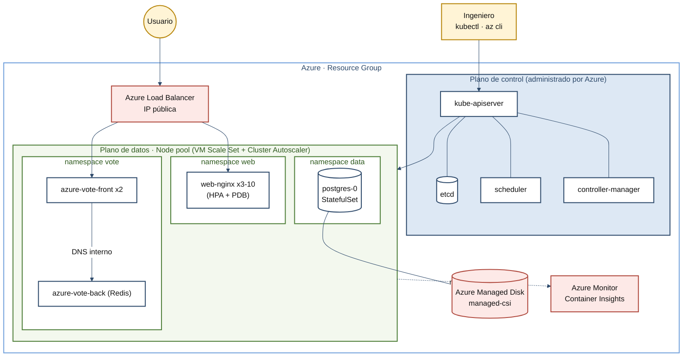

<div align="center">

# ☸️ Orquestación de Contenedores con Azure Kubernetes Service (AKS)

**Actividad Formativa · Unidad 3 — Contenerización de Aplicaciones de Software**
Maestría en Arquitectura de Software · Politécnico Grancolombiano

`Kubernetes` · `AKS` · `Azure` · `StatefulSet` · `HPA` · `Rolling Update`

</div>

---

## Contenido del repositorio

- `README.md` → Este documento: visión general, arquitectura y guía de ejecución
- `k8s/00-namespaces.yaml` → Namespaces con Pod Security Standards y cuota de recursos
- `k8s/10-web-nginx.yaml` → App 1: web stateless (ConfigMap, Deployment, Service LoadBalancer, HPA, PDB)
- `k8s/20-azure-vote.yaml` → App 2: microservicios con una mini-aplicación propia de votación (frontend en Python sobre `python:3.12-alpine`, código montado desde un ConfigMap) + Redis, con descubrimiento por DNS
- `k8s/30-postgres-statefulset.yaml` → App 3: PostgreSQL con StatefulSet y volumen persistente (Azure Disk)
- `k8s/40-ingress.yaml` → Ingress opcional con el add-on Application Routing
- `scripts/01-crear-cluster.sh` → Crea el resource group y el clúster AKS
- `scripts/02-desplegar.sh` → Despliega las tres aplicaciones y espera su disponibilidad
- `scripts/03-demos-operativos.sh` → Autocuración, escalado, persistencia, rolling update, rollback y HPA
- `scripts/99-limpiar.sh` → Elimina el resource group completo (evita costos residuales)
- `docs/guion-video.md` → Guion minuto a minuto del video (solo pantalla y voz)
- `docs/narracion-video.md` → Texto completo de la narración del video, listo para leer
- `docs/publicacion-foro.md` → Texto de la publicación para el foro
- `docs/comentarios-companeros.md` → Guía y banco de argumentos para comentar y responder
- `docs/mapa-mental.md` → Mapa mental de los servicios (Mermaid) y método para completarlo
- `docs/comparativa-aks-eks-gke.md` → Matriz técnica y matriz de decisión ponderada
- `docs/img/arquitectura-1080p.png` → Diagrama de arquitectura 1920x1080 para video y pantalla compartida
- `docs/img/arquitectura-4k.png` → Diagrama de arquitectura en 3840x2160 (2x)
- `docs/img/arquitectura.svg` → Diagrama de arquitectura vectorial
- `docs/img/generar_arquitectura.py` → Script (Python + matplotlib) que regenera las tres versiones del diagrama

---

## Arquitectura

![Arquitectura AKS: el ingeniero (kubectl, az cli, portal) llega al kube-apiserver del plano de control administrado por Azure (etcd, scheduler, controller-manager); este gestiona el plano de datos, un node pool con VM Scale Set y Cluster Autoscaler, con tres namespaces: web (nginx 3 a 10 réplicas con HPA y PDB), vote (azure-vote-front x2 hacia azure-vote-back Redis ClusterIP por DNS interno) y data (postgres-0 StatefulSet con PVC de 1 GiB en Managed Disk managed-csi). El usuario final entra por Internet al Azure Load Balancer con IP pública, que reparte hacia nginx y azure-vote-front; Azure Monitor / Container Insights recibe métricas y logs, y Microsoft Entra ID / Workload Identity da identidad a los pods.](docs/img/arquitectura-1080p.png)

Versiones: [4K (3840x2160)](docs/img/arquitectura-4k.png) · [SVG](docs/img/arquitectura.svg)

<details>
<summary>Diagrama original en Mermaid</summary>



</details>

---

## Ejecución

**Requisitos:** suscripción de Azure, Azure CLI (`az login`), `kubectl`, `openssl`.

```bash
# 1. Crear el clúster (≈ 5-10 min). Variables opcionales: RG, LOCATION, CLUSTER, NODE_SIZE
./scripts/01-crear-cluster.sh

# 2. Desplegar las tres aplicaciones
./scripts/02-desplegar.sh

# 3. Probar (IP pública de cada Service)
kubectl get svc -n web web-nginx
kubectl get svc -n vote azure-vote-front

# 4. Demos operativas (autocuración, escalado, rolling update, rollback, HPA)
./scripts/03-demos-operativos.sh

# 5. Limpieza (¡importante para no generar costos!)
./scripts/99-limpiar.sh
```

> 💡 Los flags de `az aks create` evolucionan; si un parámetro falla, revisa `az aks create --help`.
> Costo estimado de la demo: clúster en nivel **Free** con 2 nodos pequeños — elimina el resource group al terminar.

---

## Autor

**Alejandro De Mendoza** · [AlejoTechEngineer](https://github.com/AlejoTechEngineer)

<div align="center">

*Módulo Contenerización de Aplicaciones de Software · Unidad 3*

</div>
