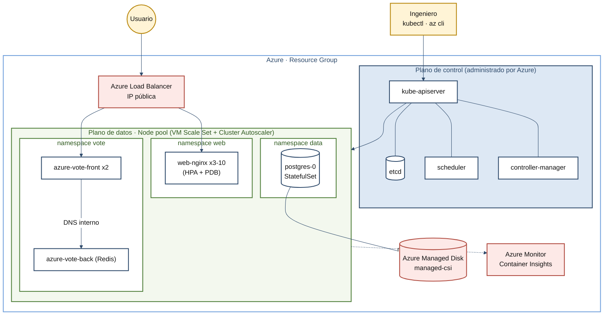
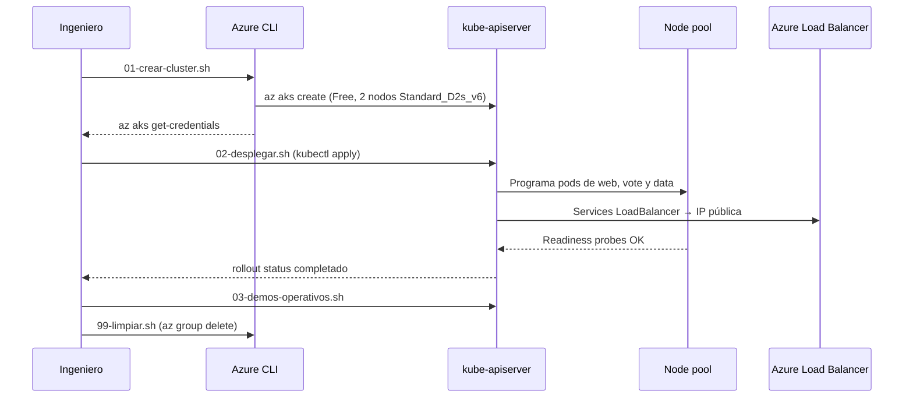

<div align="center">

# ☸️ Orquestación de Contenedores con Azure Kubernetes Service (AKS)

### *Tres aplicaciones (stateless, microservicios y stateful) desplegadas en AKS, demos operativas Day-2 y comparativa AKS · EKS · GKE*

**Módulo: Contenerización de Aplicaciones de Software · Maestría en Arquitectura de Software · Politécnico Grancolombiano · Unidad 3**

[]()
[]()
[]()
[]()
[]()
[]()
[]()

🎥 **Video de la demostración:** https://youtu.be/Cu-VVzfo1dg

**[Contexto](#-contexto-y-alcance) • [Contenido](#-contenido-del-repositorio) • [Tecnologías](#-tecnologías-utilizadas) • [Arquitectura](#-arquitectura) • [Ejecución](#-ejecución) • [Demos](#-demos-operativas) • [Autor](#-autor)**


</div>

---

## 📋 Tabla de Contenidos

- [🎯 Contexto y Alcance](#-contexto-y-alcance)
- [📁 Contenido del Repositorio](#-contenido-del-repositorio)
- [🧰 Tecnologías Utilizadas](#-tecnologías-utilizadas)
- [🏗️ Arquitectura](#-arquitectura)
- [📦 Aplicaciones Desplegadas](#-aplicaciones-desplegadas)
- [🔁 Flujo de Despliegue](#-flujo-de-despliegue)
- [🧩 Del Enunciado al Proyecto](#-del-enunciado-al-proyecto)
- [🚀 Ejecución](#-ejecución)
- [🛠️ Demos Operativas](#-demos-operativas)
- [✅ Decisiones de Diseño](#-decisiones-de-diseño)
- [💰 Costos](#-costos)
- [📝 Nota](#-nota)
- [👤 Autor](#-autor)

---

## 🎯 Contexto y Alcance

Este repositorio contiene los manifiestos, scripts y material de apoyo de la **Actividad Formativa de la Unidad 3: Software de orquestación para gestionar contenedores**. La actividad pide elegir un servicio de Kubernetes administrado en la nube, investigar su funcionamiento, componentes y características diferenciadoras, y mostrar en video el despliegue de aplicaciones. El servicio elegido es **Azure Kubernetes Service (AKS)**.

En vez de desplegar una sola aplicación de ejemplo, se despliegan **tres cargas de trabajo distintas**, una por namespace, para cubrir los tres patrones típicos: una web sin estado, una aplicación de microservicios y una base de datos con estado y volumen persistente.

> **Problema:** mostrar cómo AKS orquesta aplicaciones reales, no solo cómo se crea un clúster.
> **Enfoque:** manifiestos declarativos versionados, scripts reproducibles y demos operativas paso a paso.
> **Alcance:** 1 clúster AKS → 3 namespaces → 3 aplicaciones → 6 demos Day-2 → comparativa con EKS y GKE.

### 🌟 ¿Qué demuestra este proyecto?

- ☸️ **Tres patrones de carga** en un mismo clúster: stateless (NGINX), microservicios (frontend + Redis) y stateful (PostgreSQL).
- 🔐 **Seguridad por namespace** con Pod Security Standards (`restricted` / `baseline`), contenedores sin root y `capabilities` eliminadas.
- 📈 **Escalado automático** en dos niveles: HPA para pods (3 a 10 réplicas) y Cluster Autoscaler para nodos (fijado en 2 por el cupo de la suscripción de prueba).
- 💾 **Persistencia real**: un dato escrito en PostgreSQL sobrevive al borrado del pod gracias a un Azure Managed Disk.
- 🔄 **Rolling update sin downtime** (`maxUnavailable: 0`) y **rollback** a la revisión anterior.
- 🔑 **Sin secretos en el repositorio**: la contraseña de PostgreSQL se genera al vuelo en el despliegue.
- ⚖️ **Comparativa técnica** AKS · EKS · GKE con matriz de decisión ponderada.

---

## 📁 Contenido del Repositorio

<table align="center">
  <tr><th>Elemento</th><th>Descripción</th></tr>
  <tr><td colspan="2"><b>📂 raíz</b></td></tr>
  <tr><td><code>README.md</code></td><td>📄 Este documento: visión general, arquitectura y guía de ejecución</td></tr>
  <tr><td colspan="2"><b>📂 k8s/</b></td></tr>
  <tr><td><code>00-namespaces.yaml</code></td><td>🧱 Namespaces <code>web</code>, <code>vote</code> y <code>data</code> con Pod Security Standards y cuota de recursos</td></tr>
  <tr><td><code>10-web-nginx.yaml</code></td><td>🌐 <b>App 1</b>: web stateless (ConfigMap, Deployment, Service LoadBalancer, HPA, PDB)</td></tr>
  <tr><td><code>20-azure-vote.yaml</code></td><td>🗳️ <b>App 2</b>: microservicios con una mini-app de votación propia (Python sobre <code>python:3.12-alpine</code>, código montado desde un ConfigMap) + Redis, con descubrimiento por DNS</td></tr>
  <tr><td><code>30-postgres-statefulset.yaml</code></td><td>🐘 <b>App 3</b>: PostgreSQL con StatefulSet, Service headless y volumen persistente (Azure Disk)</td></tr>
  <tr><td><code>40-ingress.yaml</code></td><td>🚪 Ingress opcional con el add-on Application Routing (NGINX administrado)</td></tr>
  <tr><td colspan="2"><b>📂 scripts/</b></td></tr>
  <tr><td><code>01-crear-cluster.sh</code></td><td>🏗️ Crea el resource group y el clúster AKS</td></tr>
  <tr><td><code>02-desplegar.sh</code></td><td>🚀 Despliega las tres aplicaciones y espera su disponibilidad</td></tr>
  <tr><td><code>03-demos-operativos.sh</code></td><td>🛠️ Autocuración, escalado, persistencia, rolling update, rollback y HPA</td></tr>
  <tr><td><code>99-limpiar.sh</code></td><td>🧹 Elimina el resource group completo (evita costos residuales)</td></tr>
  <tr><td colspan="2"><b>📂 docs/</b></td></tr>
  <tr><td><code>guion-video.md</code></td><td>🎬 Guion minuto a minuto del video</td></tr>
  <tr><td><code>publicacion-foro.md</code></td><td>💬 Texto de la publicación para el foro</td></tr>
  <tr><td><code>comentarios-companeros.md</code></td><td>🗣️ Guía y banco de argumentos para comentar y responder</td></tr>
  <tr><td><code>mapa-mental.md</code></td><td>🧠 Mapa mental de los servicios (Mermaid) y método para completarlo</td></tr>
  <tr><td><code>comparativa-aks-eks-gke.md</code></td><td>⚖️ Matriz técnica y matriz de decisión ponderada</td></tr>
  <tr><td colspan="2"><b>📂 docs/img/</b></td></tr>
  <tr><td><code>arquitectura-1080p.png</code></td><td>🖼️ Diagrama de arquitectura 1920x1080 para video y pantalla compartida</td></tr>
  <tr><td><code>arquitectura-4k.png</code></td><td>🖼️ Diagrama de arquitectura en 3840x2160</td></tr>
  <tr><td><code>arquitectura.svg</code></td><td>🖼️ Diagrama de arquitectura vectorial</td></tr>
  <tr><td><code>generar_arquitectura.py</code></td><td>🐍 Script (Python + matplotlib) que regenera las tres versiones del diagrama</td></tr>
</table>

---

## 🧰 Tecnologías Utilizadas

<div align="center">


</div>

| Componente | Uso |
|:---|:---|
| **Azure Kubernetes Service** | Clúster administrado, nivel **Free**, Azure CNI Overlay, Cluster Autoscaler y Workload Identity |
| **Azure CLI + `kubectl`** | Creación del clúster, credenciales y despliegue de los manifiestos |
| **NGINX (`nginx-unprivileged`)** | App 1: web estática que muestra qué pod atiende cada petición |
| **Python 3.12 + Redis** | App 2: frontend de votación (solo librería estándar) y su backend de datos |
| **PostgreSQL 16** | App 3: base de datos con estado sobre Azure Managed Disk (`managed-csi`) |
| **Azure Monitor / Container Insights** | Métricas y logs del clúster (add-on `monitoring`) |
| **Bash** | Scripts de creación, despliegue, demos y limpieza (en Windows, con Git Bash o WSL) |
| **Python + matplotlib** | Generación del diagrama de arquitectura |

---

## 🏗️ Arquitectura

![Arquitectura AKS: el ingeniero (kubectl, az cli, portal) llega al kube-apiserver del plano de control administrado por Azure (etcd, scheduler, controller-manager); este gestiona el plano de datos, un node pool con VM Scale Set y Cluster Autoscaler, con tres namespaces: web (nginx 3 a 10 réplicas con HPA y PDB), vote (azure-vote-front x2 hacia azure-vote-back Redis ClusterIP por DNS interno) y data (postgres-0 StatefulSet con PVC de 1 GiB en Managed Disk managed-csi). El usuario final entra por Internet al Azure Load Balancer con IP pública, que reparte hacia nginx y azure-vote-front; Azure Monitor / Container Insights recibe métricas y logs, y Microsoft Entra ID / Workload Identity da identidad a los pods.](docs/img/arquitectura-1080p.png)

<div align="center">

Versiones: [4K (3840x2160)](docs/img/arquitectura-4k.png) · [SVG](docs/img/arquitectura.svg)

</div>

El **plano de control** (API server, etcd, scheduler, controller-manager) lo administra Azure; el **plano de datos** es un node pool sobre VM Scale Sets con Cluster Autoscaler. Cada aplicación vive en su propio namespace y las dos con interfaz web se publican con un `Service` de tipo `LoadBalancer`, que en AKS aprovisiona un Azure Load Balancer con IP pública.

<details>
<summary><b>🧬 Ver el diagrama en Mermaid</b></summary>



</details>

---

## 📦 Aplicaciones Desplegadas

| App | Namespace | Patrón | Objetos de Kubernetes | Exposición |
|:---:|:---:|:---|:---|:---|
| 🌐 `web-nginx` | `web` | Stateless | ConfigMap, Deployment (3 réplicas), HPA (3–10), PDB (`minAvailable: 2`), `topologySpreadConstraints` | Service `LoadBalancer` (IP pública) |
| 🗳️ `azure-vote-front` + `azure-vote-back` | `vote` | Microservicios | 2 Deployments, ConfigMap con el código del frontend, Service `ClusterIP` para Redis | Frontend por `LoadBalancer`; Redis solo interno por DNS |
| 🐘 `postgres` | `data` | Stateful | StatefulSet, Service headless, `volumeClaimTemplates` (1 GiB, `managed-csi`), Secret | Solo interno (`postgres-0.postgres`) |

<details>
<summary><b>🔐 Ver el nivel de seguridad por namespace</b></summary>

| Namespace | Pod Security (`enforce`) | Aviso (`warn`) | Motivo |
|:---:|:---:|:---:|:---|
| `web` | `restricted` | `restricted` | NGINX sin privilegios cumple el perfil más estricto |
| `vote` | `baseline` | `restricted` | El contenedor de Redis no declara un `securityContext` restringido; el aviso muestra qué le falta |
| `data` | `baseline` | `restricted` | El contenedor de PostgreSQL usa la configuración por defecto de la imagen oficial, sin `securityContext` restringido |

El namespace `web` tiene además una `ResourceQuota` (2 CPU / 2 GiB en requests, 4 CPU / 4 GiB en limits, 20 pods) para que una app no consuma todo el clúster.

</details>

---

## 🔁 Flujo de Despliegue



---

## 🧩 Del Enunciado al Proyecto

| Requisito de la actividad | Cómo se resuelve |
|:---|:---|
| **Seleccionar** un servicio de orquestación Kubernetes en la nube | Azure Kubernetes Service (AKS) |
| **Investigar** su funcionamiento, componentes y características diferenciadoras | Diagrama de arquitectura, `docs/comparativa-aks-eks-gke.md` y video |
| **Analizar** ventajas y desventajas del servicio | Matriz técnica y matriz de decisión ponderada en `docs/comparativa-aks-eks-gke.md` |
| **Mostrar ejemplos de despliegue de diferentes aplicaciones** | Tres apps en `k8s/` (stateless, microservicios y stateful) desplegadas con `scripts/02-desplegar.sh` |
| **Video** de mínimo 10 minutos | [Video en YouTube](https://youtu.be/Cu-VVzfo1dg), `docs/guion-video.md` y demos de `scripts/03-demos-operativos.sh` |
| **Comentar** el trabajo de los compañeros con justificación | `docs/comentarios-companeros.md` |
| **Mapa mental** con los servicios seleccionados por todos | `docs/mapa-mental.md` |

---

## 🚀 Ejecución

1. Tener una **suscripción de Azure**, **Azure CLI** (`az login`), `kubectl` y `openssl`.
2. Clonar el repositorio:
   ```bash
   git clone https://github.com/AlejoTechEngineer/aks-kubernetes-u3.git
   cd aks-kubernetes-u3
   ```
3. Crear el clúster (≈ 5–10 min). Variables opcionales: `RG`, `LOCATION`, `CLUSTER`, `NODE_SIZE`:
   ```bash
   ./scripts/01-crear-cluster.sh
   ```
4. Desplegar las tres aplicaciones:
   ```bash
   ./scripts/02-desplegar.sh
   ```
5. Obtener la IP pública de cada Service y abrirla en el navegador:
   ```bash
   kubectl get svc -n web web-nginx
   kubectl get svc -n vote azure-vote-front
   ```
6. Ejecutar las demos operativas y, al terminar, **limpiar**:
   ```bash
   ./scripts/03-demos-operativos.sh
   ./scripts/99-limpiar.sh
   ```

<details>
<summary><b>🚪 Ver el Ingress opcional (Application Routing)</b></summary>

```bash
az aks approuting enable -g rg-aks-u3-demo -n aks-u3-demo
export INGRESS_IP=$(kubectl get svc nginx -n app-routing-system \
    -o jsonpath='{.status.loadBalancer.ingress[0].ip}')
envsubst < k8s/40-ingress.yaml | kubectl apply -f -
```

Las apps quedan en `web.<IP>.nip.io` y `vote.<IP>.nip.io`, sin necesidad de un DNS propio.

</details>

| Acción | Comando |
|:---|:---|
| 🏗️ Crear el clúster | `./scripts/01-crear-cluster.sh` |
| 🚀 Desplegar las apps | `./scripts/02-desplegar.sh` |
| 🛠️ Demos Day-2 | `./scripts/03-demos-operativos.sh` |
| 🧹 Eliminar todo | `./scripts/99-limpiar.sh` |

> 💡 Los flags de `az aks create` evolucionan; si un parámetro falla, revisa `az aks create --help`. Si hay error de cuota o SKU, cambia `NODE_SIZE` o la región.

> ℹ️ El clúster usa **2 nodos fijos `Standard_D2s_v6`** (`--max-count 2`) porque la suscripción de prueba tiene un cupo de 4 vCPU por región y `Standard_B2s` no estaba permitido en esa región.

---

## 🛠️ Demos Operativas

`scripts/03-demos-operativos.sh` ejecuta seis escenarios y espera un Enter antes de cada uno para poder narrarlo en el video:

| # | Escenario | Qué se hace | Qué se observa |
|:---:|:---|:---|:---|
| 1 | **Autocuración** | Se elimina un pod de `web-nginx` | El ReplicaSet crea uno nuevo de inmediato |
| 2 | **Escalado manual** | `kubectl scale --replicas=5` | Los pods se reparten entre nodos |
| 3 | **Persistencia** | Se escribe una fila en PostgreSQL y se borra `postgres-0` | El pod vuelve con el mismo disco y la fila sigue ahí |
| 4 | **Rolling update** | Cambio de imagen a `nginx-unprivileged:1.27-alpine` | Los pods se reemplazan uno a uno, sin downtime |
| 5 | **Rollback** | `kubectl rollout undo` | Se vuelve a la revisión anterior |
| 6 | **HPA** | Se baja temporalmente el objetivo de CPU (a mano, con `kubectl patch`; ver `docs/guion-video.md`) y se lanza un generador de carga con 3 réplicas de BusyBox | El HPA sube réplicas en pocos segundos; el manifiesto conserva 50 % y se restaura con `kubectl apply` |

<details>
<summary><b>🔍 Ver la verificación de persistencia</b></summary>

```bash
kubectl exec -n data postgres-0 -- psql -U demo -d appdb \
  -c "CREATE TABLE IF NOT EXISTS u3(msg text); INSERT INTO u3 VALUES ('sobrevivo al reinicio');"
kubectl delete pod postgres-0 -n data
kubectl wait --for=condition=Ready pod/postgres-0 -n data --timeout=180s
kubectl exec -n data postgres-0 -- psql -U demo -d appdb -c "SELECT * FROM u3;"
# msg
# -----------------------
# sobrevivo al reinicio
```

El StatefulSet recrea el pod con el **mismo nombre** y lo vuelve a enlazar con el **mismo PVC**, así que el Azure Managed Disk conserva los datos.

</details>

---

## ✅ Decisiones de Diseño

| Decisión | Dónde se aplica |
|:---|:---|
| 🧱 **Un namespace por aplicación** con Pod Security Standards según lo que necesita cada carga | `k8s/00-namespaces.yaml` |
| 🔐 **Contenedores sin root**, `seccompProfile: RuntimeDefault` y `capabilities` eliminadas | `web-nginx`, `azure-vote-front` |
| 🔄 **Cero downtime** en actualizaciones (`maxSurge: 1`, `maxUnavailable: 0`) y PDB con `minAvailable: 2` | `k8s/10-web-nginx.yaml` |
| 🩺 **Readiness y liveness probes** en NGINX, el frontend de votación y PostgreSQL | `/healthz` en NGINX y en el frontend, `pg_isready` en PostgreSQL |
| 📏 **Requests y limits** en todos los contenedores | Todos los manifiestos |
| 🔑 **Secret generado al vuelo** con `openssl rand`; nunca se versiona | `scripts/02-desplegar.sh` |
| 🧭 **Descubrimiento por DNS interno**: el frontend encuentra a Redis por el nombre del Service | `k8s/20-azure-vote.yaml` |
| 🐍 **Mini-aplicación propia** en Python sobre `python:3.12-alpine` más Redis, porque la imagen `azure-vote-front:v1` ya no existe | ConfigMap `azure-vote-front-app` |
| 💾 **`PGDATA` en una subcarpeta** porque el Azure Disk trae `lost+found` en la raíz | `k8s/30-postgres-statefulset.yaml` |

---

## 💰 Costos

El clúster se crea en el nivel **Free** (sin costo de gestión del plano de control) con 2 nodos `Standard_D2s_v6`. Aun así, los nodos, los discos, las IPs públicas y Log Analytics sí generan costo mientras existan.

> ⚠️ **Ejecuta `./scripts/99-limpiar.sh` al terminar.** Elimina el resource group completo (clúster, discos, IPs y Log Analytics).

---

## 📝 Nota

Este proyecto corresponde a una **actividad académica** y se elaboró con fines exclusivamente formativos. Los valores de precios, SLA y funciones de los proveedores cambian con frecuencia; conviene confirmarlos en la documentación oficial antes de citarlos.

---

## 👤 Autor

<div align="center">

Este proyecto fue desarrollado en el marco del módulo **Contenerización de Aplicaciones de Software** de la **Maestría en Arquitectura de Software** del **Politécnico Grancolombiano**.

| Autor | Perfil |
|:---:|:---:|
| ***Alejandro De Mendoza*** | [](https://github.com/AlejoTechEngineer) |

</div>

---

<div align="center">

### ☸️ *Declaras el estado que quieres; Kubernetes se encarga de mantenerlo*

**Contenerización de Aplicaciones de Software · Unidad 3 · Azure Kubernetes Service**

</div>
