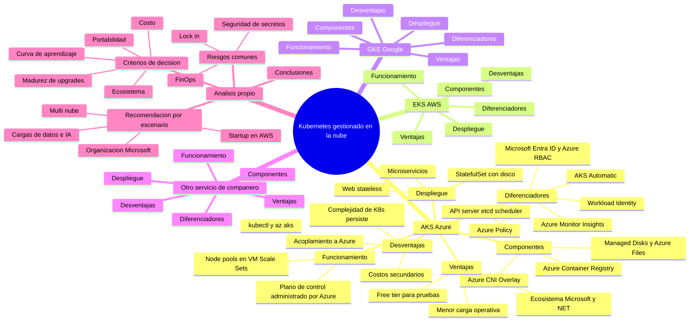

# 🧠 Mapa mental — Servicios de orquestación Kubernetes en la nube

> **Rúbrica (10 pts):**
> 10 = análisis claro + estructura definida + completo + aporta análisis propio sobre lo que mostraron los compañeros ·
> 9 = análisis, estructura no definida · 6 = recoge lo aportado, estructura definida · 3 = solo lista servicios · 0 = no presenta.
>
> **Claves para el 10/10:** (1) un **nodo por cada servicio elegido por los compañeros** (no solo el tuyo),
> (2) **las mismas ramas hijas en todos** (estructura definida y comparable),
> (3) una rama **"Análisis propio"** con conclusiones que *no* están en los videos (comparativa, recomendación por escenario).

## Versión base (completa con tu servicio; añade los de los compañeros)

## 🔧 Procedimiento para completarlo (después de ver los videos)

1. Crea una **hoja de captura** por servicio con las seis ramas fijas: *Funcionamiento · Componentes · Diferenciadores · Ventajas · Desventajas · Despliegue*.
2. Mientras ves cada video, escribe en cada rama **1–3 frases cortas con lo que realmente mostró** el compañero (así el mapa "muestra lo aportado").
3. Sustituye los nodos vacíos de `EKS`, `GKE` y `Otro servicio` por esas frases; duplica el bloque por cada servicio nuevo.
4. En **"Análisis propio"** agrega tu valor: compara, detecta patrones (p. ej. "los tres servicios administran el plano de control pero difieren en quién gestiona los nodos") y da recomendaciones por escenario.
5. Verifica que **ninguna rama quede vacía** (rúbrica: "se ve completo").

## 🖼️ Cómo obtener la imagen para el foro

- **Rápido:** pega el bloque `mermaid` en <https://mermaid.live> y exporta **PNG/SVG**.
- **Alternativa visual:** reconstruirlo en XMind, Miro, draw.io o Canva con la misma estructura (centro → 5 ramas principales → 6 sub-ramas fijas).
- Sube la imagen en el hilo del foro **y** enlaza el archivo `.md` del repositorio.

> Consejo: usa **un color por servicio** y mantén el orden de las sub-ramas idéntico en todos; es lo que hace que la "estructura esté definida".
